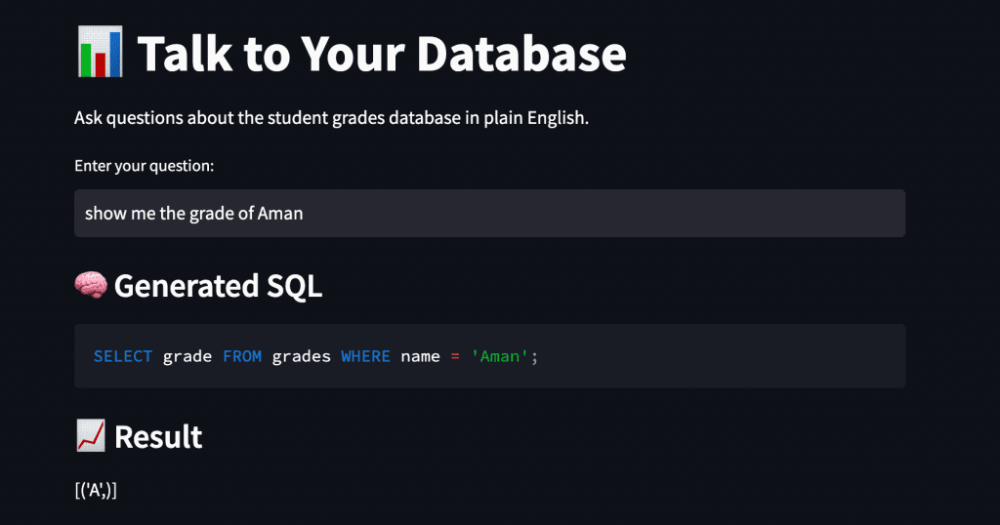

# Rora AI — Text-to-SQL Intelligence

[](https://python.org)
[](https://fastapi.tiangolo.com)
[](https://langchain.com)
[](https://docker.com)
[](LICENSE)
[](https://github.com/markotuya0/rora-ai2/actions)

> **Ask questions in plain English. Get SQL. Get answers. Includes a structured validation pipeline and benchmark regression suite — every LLM output is schema-validated and tested against  queries before deployment.**

Rora AI is full-stack AI system that transforms natural language into SQL queries using a fully local LLM stack. No external API costs. No data privacy concerns. One-command deployment.



---

## Why Rora AI?

Most Text-to-SQL tools send your data to external APIs — exposing sensitive information and incurring per-query costs. Rora AI runs entirely locally using **Ollama + Qwen 2.5**, giving you:

- **Zero API costs** — runs 100% on your machine
- **Complete data privacy** — nothing leaves your infrastructure
- **Production-grade reliability** — SQL injection prevention, query validation, error handling
- **Full observability** — benchmarking, health checks, query history, structured logging

---

## Architecture

```
┌─────────────────┐         HTTP/REST         ┌──────────────────┐
│   Streamlit UI  │ ◄───────────────────────► │  FastAPI Backend │
│   (Port 8501)   │                            │   (Port 8000)    │
└─────────────────┘                            └────────┬─────────┘
                                                        │
                                           ┌────────────┴────────────┐
                                           │                         │
                                    ┌──────▼──────┐         ┌───────▼──────┐
                                    │  LangChain  │         │    SQLite    │
                                    │  + Ollama   │         │   Database   │
                                    │  (Qwen 2.5) │         │              │
                                    └─────────────┘         └──────────────┘
```

**Request flow:**
1. User submits natural language question via Streamlit UI or REST API
2. FastAPI validates and sanitises the input via Pydantic models
3. LangChain orchestrates the LLM chain — prompt engineering, context injection, SQL generation
4. Ollama runs Qwen 2.5 locally to generate the SQL query
5. Query is validated (SELECT only, injection prevention) before execution
6. Results returned with query history logged

See [ARCHITECTURE.md](ARCHITECTURE.md) for full system design documentation.

---

## Tech Stack

| Layer | Technology |
|---|---|
| **Backend** | FastAPI, Uvicorn |
| **Frontend** | Streamlit |
| **AI Orchestration** | LangChain |
| **Local LLM** | Ollama (Qwen 2.5) |
| **Database** | SQLite (PostgreSQL-ready) |
| **Validation** | Pydantic v2 |
| **Containerisation** | Docker, Docker Compose |
| **Testing** | Pytest, unittest |
| **CI/CD** | GitHub Actions |
| **Language** | Python 3.11+ |

---

## Quick Start

### Option 1 — Docker (Recommended)

```bash
git clone https://github.com/markotuya0/rora-ai2.git
cd rora-ai2
docker-compose up --build
```

| Service | URL |
|---|---|
| REST API | http://localhost:8000 |
| API Docs (Swagger) | http://localhost:8000/docs |
| Streamlit UI | http://localhost:8501 |

### Option 2 — Local Development

```bash
git clone https://github.com/markotuya0/rora-ai2.git
cd rora-ai2

# Automated setup
chmod +x setup.sh && ./setup.sh

# Or manual
python3 -m venv .venv
source .venv/bin/activate
pip install -r requirements.txt

# Pull the local LLM
ollama pull llama3.2:3b

# Initialise database
python create_db.py

# Start API server (Terminal 1)
python api.py

# Start UI (Terminal 2)
streamlit run app_v2.py
```

### Option 3 — Makefile

```bash
make setup    # Full setup
make api      # Start API server
make ui       # Start Streamlit UI
make test     # Run all tests
make docker   # Start with Docker
```

---

## Using your own data

The demo answers from bundled student grades. To query your own database, set `DEMO_MODE=false` and `DB_URI`.
See [docs/DEMO_AND_REAL_DATA.md](docs/DEMO_AND_REAL_DATA.md) for setup, the read-only user advice, and what the guided view shows.

## API Reference

| Method | Endpoint | Description |
|---|---|---|
| `GET` | `/` | API info and version |
| `POST` | `/query` | Execute natural language query |
| `GET` | `/history` | Retrieve query history |
| `GET` | `/schema` | Get database schema |
| `GET` | `/health` | Health check |
| `GET` | `/docs` | Interactive Swagger documentation |

### Example Usage

```bash
# Health check
curl http://localhost:8000/health

# Natural language query
curl -X POST http://localhost:8000/query \
  -H "Content-Type: application/json" \
  -d '{"question": "Who scored the highest in Math?"}'

# Response
{
  "question": "Who scored the highest in Math?",
  "sql_query": "SELECT student_name, score FROM grades WHERE subject = 'Math' ORDER BY score DESC LIMIT 1",
  "results": [{"student_name": "Alice", "score": 98}],
  "execution_time": 0.23
}

# Query history
curl http://localhost:8000/history?limit=10
```

---

## Example Queries

```
"Who scored the highest in Math?"
"Show all students with grade A"
"What is the average score in Science?"
"List students who scored below 70"
"How many students passed History?"
"Which subject has the lowest average score?"
```

---

## Security

| Feature | Implementation |
|---|---|
| SQL Injection Prevention | Parameterised queries + input validation |
| Query Restriction | SELECT statements only — no destructive queries |
| Input Validation | Pydantic v2 models on all endpoints |
| Local Processing | Zero data sent to external services |
| CORS Configuration | Controlled cross-origin access |
| Error Handling | Safe error messages — no internal exposure |

---

## Testing

```bash
# Full test suite
make test

# Unit tests
python -m pytest test_utils.py -v

# API integration tests
python -m pytest test_api.py -v

# Performance benchmarks
python benchmark.py
```

---

## Project Structure

```
rora-ai/
├── .github/workflows/ci.yml    # GitHub Actions CI/CD
├── images/                     # Screenshots and assets
├── api.py                      # FastAPI REST API
├── app_v2.py                   # Streamlit UI
├── config.py                   # Configuration management
├── create_db.py                # Database initialisation
├── benchmark.py                # Performance testing
├── test_api.py                 # API integration tests
├── test_utils.py               # Unit tests
├── requirements.txt            # Python dependencies
├── Dockerfile                  # Container definition
├── docker-compose.yml          # Multi-service orchestration
├── .env.example                # Environment variables template
├── Makefile                    # Development commands
├── setup.sh                    # Automated setup script
├── ARCHITECTURE.md             # System architecture
├── DEPLOYMENT.md               # Deployment guide
├── INTERVIEW_GUIDE.md          # Technical deep-dive
└── CONTRIBUTING.md             # Contribution guidelines
```

---

## Deployment

### Docker
```bash
docker-compose up -d
```

### Cloud Options
- **AWS** — ECS/Fargate + RDS PostgreSQL
- **GCP** — Cloud Run + Cloud SQL
- **Railway** — One-click container deployment
- **Render** — Free tier Docker deployment

See [DEPLOYMENT.md](DEPLOYMENT.md) for full cloud deployment instructions.

---

## Roadmap

- [x] FastAPI REST API with OpenAPI docs
- [x] Streamlit interactive UI
- [x] LangChain + Ollama local LLM integration
- [x] Query history and logging
- [x] SQL injection prevention
- [x] Docker + Docker Compose
- [x] GitHub Actions CI/CD
- [x] Performance benchmarking
- [x] Demo mode flag and real-data mode (`DEMO_MODE=false`, see [docs/DEMO_AND_REAL_DATA.md](docs/DEMO_AND_REAL_DATA.md))
- [x] Guided answer view (step-by-step explanation of each query)
- [x] Next.js dashboard with keyboard shortcuts and query export
- [x] Rate limiting (in-memory, per client)
- [~] JWT authentication (scaffold, off by default: set `AUTH_ENABLED=true`)
- [ ] PostgreSQL support (`DB_URI` is wired; not yet verified against a live server)
- [ ] Redis caching layer
- [ ] Multi-database support (MySQL, PostgreSQL, MSSQL)
- [ ] Data visualisation charts
- [~] Query result export (CSV in the dashboard; JSON not yet)
- [ ] LangSmith observability integration

---

## Author

**Mark Otuya** — Full-Stack & AI Engineer

- Portfolio: [markotuya.netlify.app](https://markotuya.netlify.app)
- LinkedIn: [linkedin.com/in/mark-chukwu](https://linkedin.com/in/mark-chukwu)
- GitHub: [@markotuya0](https://github.com/markotuya0)
- Resume Refined (AI SaaS): [resume-refined-sooty.vercel.app](https://resume-refined-sooty.vercel.app)

---

## License

MIT License — see [LICENSE](LICENSE) for details.

---

*Built with FastAPI, LangChain, Ollama, and a lot of late nights.*
